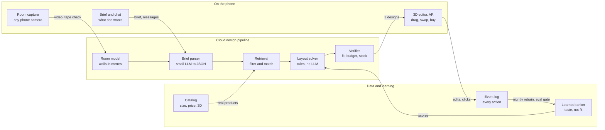

# System architecture

The room model and the catalog are the two sources of truth; every design flows through the solver and must pass the verifier before it reaches the phone.

Learning changes ranking only. Hard rules and the verifier stay fixed.

Read it left to right, then down: the phone captures the room and the brief, the cloud pipeline builds and checks three designs, and every action she takes in the editor feeds the nightly ranker training. The LLM appears in exactly one box.
