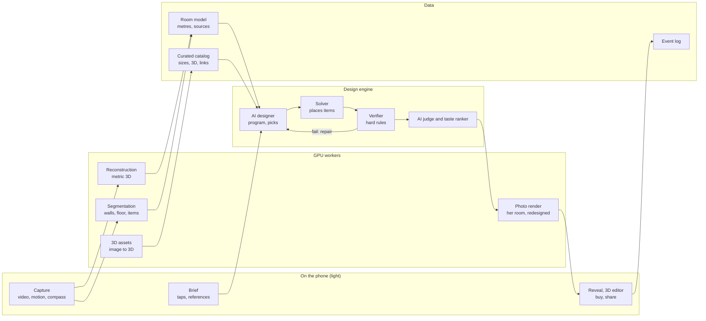

# System architecture

The room model and the catalog are the two sources of truth. Every design flows through the solver and must pass the verifier before it reaches the phone. AI models sit around the solver, never in place of it.

- **Phone:** captures video, motion data and compass headings; shows guides, the reveal and the editor. No heavy AI on the device.
- **GPU workers:** scale to zero when idle. Reconstruction, segmentation, photo renders and 3D asset generation.
- **Design engine:** CPU service plus model calls. The AI designer proposes; the solver places; the verifier decides; the judge and taste ranker order what survives.
- **Data:** Postgres with pgvector for rooms, catalog and embeddings; object storage for media; an event log from day one for v2 learning.
- **API:** one Python modular monolith. Separate services only when load proves it necessary.
