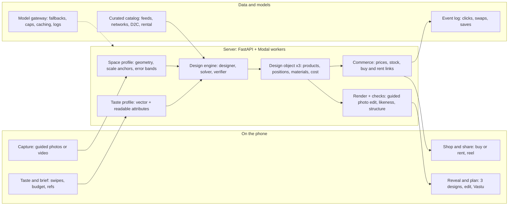

# System architecture

The phone stays light. The server turns your inputs into a Space Profile and a Taste Profile, the engine produces three `Design` objects, and render, plan and commerce are all derived from them.

## Components

- **Mobile app (Expo).** Capture with on-device quality checks, resumable uploads, taste swipes, reveal, plan editor, shopping list, Vastu view, share. No heavy AI on the device.
- **API (FastAPI on Cloud Run, Mumbai).** Stateless modular monolith with modules for auth, rooms, taste, designs, catalog, commerce, Vastu and admin. Versioned `/v1`, OpenAPI generated, typed client generated for the app.
- **Workers (Modal).** Durable pipeline steps: frame selection, geometry, layout, segmentation, design engine, render and checks, reel. GPU steps scale to zero.
- **Model gateway.** One library every model call goes through: provider routing, fallbacks, concurrency limits, circuit breakers, spend caps, caching by content hash, structured logging.
- **Data (Supabase, Mumbai).** Postgres with JSONB for Room and Design objects, pgvector for taste and product search, row-level security, Auth, Realtime for job status.
- **Media (Cloudflare R2 + image CDN).** Photos, renders, reels; signed URLs; zero egress fees.
- **Redirect service.** Every buy or rent tap gets a click ID (user, design, product, position) before going to the retailer.
- **Admin (web).** Catalog curation, user support, flags, cost dashboard.

## Job pipeline

A room is a job of steps. Each step stores its result, retries safely with an idempotency key and resumes where it stopped. A failed render retries only the render and never charges twice. Status reaches the app through Realtime with a polling fallback. A push notification when renders finish comes after launch.
